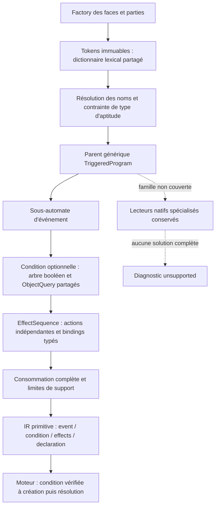

# Parent syntaxique générique des déclenchements — 14 novembre 2026

Le parser compose désormais un événement, une condition booléenne facultative
et un programme d'actions typés sur le même flux de tokens. Ce checkpoint ajoute
**8 cartes entièrement reconnues dans les dix sets locaux**, et **93 dans le corpus
local de 39 288 entrées**. Ce sont des scores de parsing natif complet ; ils ne
certifient pas la simulation individuelle de toutes ces cartes.

## Structure acceptée

- `automata/trigger_envelope.rs` partage la reconnaissance des événements
  source, sort lancé, sacrifice, étapes, entrées/morts filtrées et événements locaux.
- `automata/trigger_program.rs` compose `SyntaxNode<T>` avec des plages de tokens
  et `TriggeredProgramNode { event, guard, program }`. Le parent possède les
  virgules structurelles et la consommation complète ; les enfants possèdent
  leur syntaxe. Aucun texte Oracle n'est reconstruit ni rematché.
- `automata/trigger_guard.rs` réutilise les arbres booléens, les requêtes d'objets
  et les compteurs existants. Les listes de longueur arbitraire gardent la priorité
  AND/OR ; une virgule du parent reste au parent. Les anciens lecteurs gardent
  leurs limites par défaut. Les préfixes `at least N` et `at most N` utilisent le
  même automate que `N or more/fewer`.
- `effects/trigger_program.rs` assemble la condition à la racine de l'aptitude,
  hors des effets. Le moteur peut ainsi la vérifier aux deux moments requis.
- Le journal de construction contient les étapes réellement produites par le
  nouveau parent, leurs plages et l'IR finale. Ce ne sont pas trois réanalyses
  complètes du texte. Les autres familles conservent leur journal historique.
- Le parent commun passe avant les lecteurs spécialisés. Une compatibilité
  atomique Surveil conserve ses anciens identifiants de décisions ; une lecture
  partielle ne suffit jamais à revendiquer cette priorité. Les autres familles
  syntaxiques ne sont pas toutes réécrites par ce checkpoint.
- Le sélecteur commun compose `noncreature, nonland permanent` comme une
  intersection de restrictions. Les unions explicites et les virgules des parents
  gardent leur portée. Aucun validateur moteur n'est affaibli.
- Le lexique ajoute `combat`, `least`, `most`. Aucun nouveau kind de primitive
  moteur, branchement par carte, regex ou effet combiné n'est introduit.

## Dix sets : mêmes entrées, ordre et hashes

| Set local | Cartes | Complètes avant | Complètes après | Gain cartes | Gain capacités |
|---|---:|---:|---:|---:|---:|
| Star Trek (TRK) | 311 | 37 | 37 | +0 | +1 |
| Mystery Booster Commander Edition (MBC) | 80 | 8 | 8 | +0 | +2 |
| Reality Fracture (FRA) | 285 | 40 | 41 | +1 | +5 |
| The Hobbit (HOB) | 193 | 16 | 17 | +1 | +1 |
| Marvel Super Heroes (MSH) | 281 | 28 | 28 | +0 | +2 |
| Secrets of Strixhaven (SOS) | 271 | 40 | 42 | +2 | +4 |
| Teenage Mutant Ninja Turtles (TMT) | 195 | 28 | 29 | +1 | +3 |
| Lorwyn Eclipsed (ECL) | 273 | 24 | 26 | +2 | +2 |
| Avatar: The Last Airbender (TLA) | 286 | 37 | 37 | +0 | +1 |
| Marvel's Spider-Man (SPM) | 193 | 17 | 18 | +1 | +1 |
| **Total des occurrences** | **2368** | **275** | **283** | **+8** | **+22** |

Les sommes sont dérivées des lignes. Après déduplication inter-set par `oracle_id` :
**2319 cartes**, **227 → 235 complètes**. Les trois entrées sans texte restent
séparées. Le résultat complet ne compte aucune aptitude partiellement reconnue
comme un succès de carte.

Nouvelles cartes complètes dans ces sets :

- Frostbite Pyromental (FRA)
- Nasty Little Rabbit (HOB)
- Shopkeeper's Bane (SOS)
- Bogwater Lumaret (SOS)
- Donatello, Turtle Techie (TMT)
- Moonglove Extractor (ECL)
- Thoughtweft Lieutenant (ECL)
- Agent Venom (SPM)

## Généralisation et absence de régression

Replay global figé : **39 288 entrées / 67 417 capacités**. Les **16 874 IR
précédemment natives sont strictement préservées** : comparaison structurelle,
sensible à la casse et aux types, sans normalisation de noms ou de bindings.
Les cartes non vides entièrement natives passent de **3409 à 3502** ; les
capacités natives passent de **16874 à 17124**. Les **3144 entrées sans texte**
sont comptées séparément. Aucune capacité reconnue ne recule.

Le gain récent reste modeste : le parent partagé supprime des blocages de
composition, mais plusieurs corps d'actions, modes et liaisons restent inconnus.
Le classement syntaxique initial de 100 échecs était une borne optimiste,
pas une promesse de couverture ; les replays réels font autorité.

## Preuves

- **433/433 fixtures parser**, en NativeOnly et en Full, sans `fixtureError`.
  Quatre anciennes exclusions deviennent des positifs avec égalité IR exacte.
- **13 tests événement/guard + 6 tests de sélecteur négatif** passent dans le
  passage élargi ; **2 tests comparatifs** et **3 tests du dictionnaire** passent.
- **11 scénarios runtime DATA / 81 assertions** passent avec un runner frais.
  Ils vérifient condition absente à création, présence sur pile, disparition
  avant résolution, effet à résolution, et exclusions de cibles.
- **1 test runtime autonome / 4 scénarios de combat** passe : source vers joueur,
  dégâts non combat, autre source, dégâts vers créature. Il traverse la vraie
  résolution des dégâts, la création de pile et la résolution du déclenchement.
- L'IR réellement émise depuis les textes complets de Scholar of Stars,
  Lagonna-Band Elder et Frostbite Pyromental est reliée aux règles des fixtures,
  avec hashes Oracle, entrée et IR. Les arrangements runtime ont des coûts et
  statistiques synthétiques ; ce ne sont pas des parties complètes certifiées.
- Le passage élargi reste rouge sur **les mêmes dix tests privés préexistants**.
  Ils ont été reproduits avec les lecteurs/repartiteur antérieurs ; aucun n'est
  déclaré corrigé ou retiré. Les gates ciblés et DATA sont verts.

## Temps mesurés

| Étape | Compilation / link | Exécution | Portée |
|---|---:|---:|---|
| Build release final | 31.144 s | — | Parser et runner stables |
| Link analyseur | 1.469 s | — | Même profil optimisé que baseline |
| Fixtures NativeOnly | 0 s additionnelle | 0.531 s processus / 0.304 s runner | 433 cas |
| Fixtures Full | 0 s additionnelle | 0.568 s processus / 0.201 s runner | 433 cas |
| Tests comparatifs | 8.877 s | 0.903 s harness | 2 tests |
| Tests dictionnaire | 0.310 s, artefacts frais | 0.020 s harness | 3 tests |
| Runtime combat autonome | 67.628 s | 1.025 s harness / 0.010 s tests | 4 scénarios |
| Runtime DATA | 38.757 s | 0.898 s processus | 11 scénarios / 81 assertions |

Une première compilation de combat de **92.32 s** n'a exécuté aucun test à cause
d'un rattachement à un module désactivé sans `oracle-compilation`. Le garde-fou
l'a refusée. Ce temps est conservé comme une itération de diagnostic, jamais
comme une preuve. La version acceptée est directement rattachée au moteur autonome.

Benchmark warm : même fichier ordonné de 2368 occurrences, une paire de
chauffe puis cinq paires alternées, sans autre Cargo root en parallèle.
Médiane interne parser : **0.626 s avant / 0.628 s après**. L'écart est dans
la variabilité observée ; aucun gain de vitesse global n'est revendiqué.
Le surcroît de couverture n'a pas de ralentissement significatif démontré.

## Limites conservées et suite

- Les programmes déclenchés modaux restent fermés dans le nouveau parent :
  le moteur choisit certains modes à la résolution plutôt qu'à la mise en pile.
- Tous les nouveaux guards `other` restent fermés. L'objet à exclure peut être
  l'objet déclencheur plutôt que la source. Un probe séparé reproduit aussi un
  défaut historique : `excludeSource` soustrait parfois une source déjà partie.
  Roiling Canopy n'est donc pas comptée comme couverte.
- Les limites sur caractéristiques numériques de sorts en pile, snapshots de
  sacrifices, ellipses de conditions et variables sans producteur restent explicites.
- La mission toutes-cartes continue avec une nouvelle cohorte rotative au plus100,
  le classement des blocages par cartes complètes, l'itération des primitives,
  et un seul lane Cargo. Les anciens certificats restent immuables.

## Artefacts reproductibles

- Rapport dix sets : `.tmp/generic-ast-ten-sets-analysis/replay/comparison.json`
- Manifestes identités/hashes : même dossier `run-manifest.json`
- Global : `.tmp/generic-ast-root/global-comparison.json`
- Benchmark : `.tmp/generic-ast-root/benchmark-report.json`
- Liens parser/runtime : `.tmp/generic-ast-root/vertical-proof-links.json`
- Baseline des tests privés : `.tmp/generic-trigger-count-staging/broad-unit-failure-review.json`
- Timings : `.tmp/generic-ast-root/*unit.json`, `runtime-*.json`, `*-build.process.json`
- Analyseur accepté : `.tmp/generic-ast-root/after-analyzer.exe`, SHA
  `E04B1CE3915A965EB7D5EAB2997D606B6559BBDF30EBBCFEEBD1EA8D7EB3D089`

Aucun commit, merge ou reset effectué ; index Git conservé.
